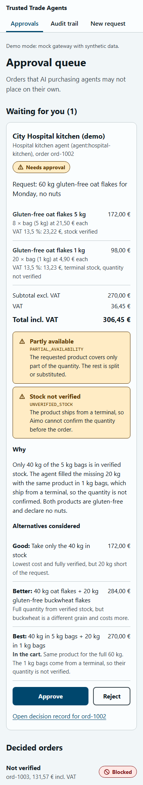

# @junction/ui

Approval app and audit views for the Aimo Agent Gateway (PLAN-review step 9). Vite + React + TypeScript, plain CSS, phone-first.

Screens (hash routes): `#/queue` approval queue, `#/orders/:orderId` order detail with decision record, `#/audit` audit trail (Buyer view, Aimo view), `#/request` request form.



## Run

```bash
npm install
npm run dev        # mock gateway, synthetic demo data
npm test
npx tsc --noEmit
npm run build
```

Real gateway: set `VITE_GATEWAY_URL` (for example `VITE_GATEWAY_URL=http://localhost:3000 npm run dev`). When it is unset the app uses `MockGatewayApi` (in memory, seeded with the three demo scenes) and shows a "Demo mode" note. The gateway must allow CORS from the UI origin.

## Gateway contract

Types, schemas, reason-code copy (`REASON_CODE_INFO`) and the hashing rule come from `@junction/shared`. Gateway responses are parsed with the shared Zod schemas; a payload that does not match is shown as an error. Money is decimal EUR as in shared (`64.17`), shown as `64,17 €`; totals are read from `Order.totals` / `OrderLine.totals`, never recomputed. `vatRate` is a percent (`13.5`).

| Method and path | Source | Request body | Response |
|---|---|---|---|
| `GET /v1/orders/{orderId}` | `TOOLS.get_order` | | `{ order: Order }` |
| `POST /v1/orders/{orderId}/approve` | `TOOLS.approve_order` | `ApproveOrderInput` (whole input, incl. `orderId`) | `{ order: Order }` |
| `POST /v1/orders/{orderId}/reject` | `TOOLS.reject_order` | `RejectOrderInput` (whole input, incl. `orderId`) | `{ order: Order }` |
| `GET /api/orders` | not in shared yet | | `Order[]` |
| `GET /api/audit?scope=buyer\|aimo` | not in shared yet | | `AuditEvent[]`, ascending `seq`, filtered by `visibility` |
| `POST /api/requests` | not in shared yet | `{ "text": string }` | the resulting `Order` |
| `GET /api/events` | not in shared yet | | SSE, one unnamed message per new `AuditEvent` (JSON) |

The UI treats every SSE message as "something changed" and refetches the screen it shows, so every order status change must produce an audit event. Only `pending_approval` orders can be approved or rejected.

## Hashing rule

As defined in shared `audit.ts`: `hash = lowercase hex(SHA-256(auditHashInput(event)))`, i.e. the canonical JSON of every field except `hash` (so `prevHash` is included). `seq` starts at 0, whose `prevHash` is `GENESIS_HASH`. The UI recomputes it with Web Crypto (`src/hash.ts`); a test checks it against the shared fixture chain.

Verification: every event's hash is recomputed; `prevHash` is compared with the previous event when that event is in the list. In the buyer view some previous events are Aimo-only and not in the list: those links are counted and reported as "checked in the Aimo view", they do not break the indicator.

## Provisional and shortcuts

- `src/contract.ts` holds the only UI-only types: `agentName`, `alternatives` (good / better / best) and `trace` on top of the shared `Order`. Only the mock fills them; the screens hide them when absent.
- The approver is a fixed human actor `Demo approver` (no sign-in in the prototype).
- Mock `submitRequest` has no agent behind it: text containing "milk" clones the auto-approved cart, anything else clones the needs-approval cart.
- The rogue scene needs a `mandateId` and `customerRef` because shared `Order` requires them; it uses placeholder values and Aimo-only audit events. All mock data is synthetic, none comes from the Aimo dataset.
- "Demo: tamper with event" (audit screen, mock only) edits one stored event to show the chain breaking.
